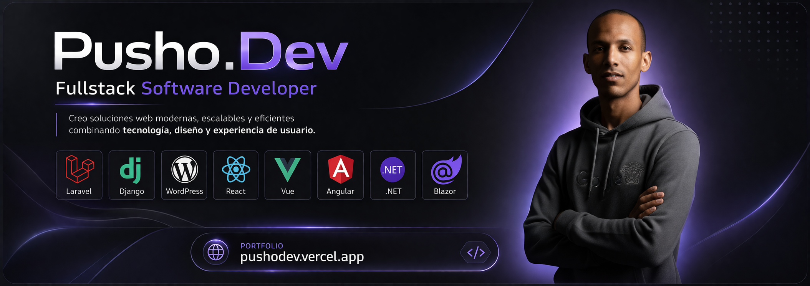

  <kbd></kbd>
  <kbd></kbd>

---

<table align="center">
  <tr>
    <td width="60%" valign="top">

  <h2>👋 Hi! I'm <b>PushoDev (Luis Alberto Guisado)</b></h2>
  
💻 <b>Fullstack Developer with 8+ years of experience</b> building production web systems: a marketplace, a multi-warehouse ERP/POS, and mobile and desktop apps. I work with <b>Laravel, React, Python (Django/FastAPI) and .NET</b>, and my daily environment is <b>Linux with Podman</b>.

  
⛓️ I'm moving from <b>Fullstack to Fullstack Blockchain</b>: learning Solidity and Foundry, and integrating contracts with Laravel and React. Still learning; the Web3 projects in my portfolio are ideas, not finished products.

  
🌍 <b>Open to remote work</b>. Based in Cuba (UTC-5), with a <b>negotiable time zone</b>: I adapt to your team's schedule.

  

  
  
  
  

  </td>
  <td width="40%" align="center">
    
  </td>
  </tr>
</table>

---

<h3 align="center">💻 Fullstack Engineer | Laravel • React • Python • .NET | Production systems · Remote work</h3>

---

## 🌟 About me

> *Turning ideas into scalable digital solutions through clean code and modern technologies.*

I'm the founder of **GolfitoShop** (a local marketplace in production) and I build **custom systems** for real businesses: sales, multi-warehouse inventory, cash-register closings and Telegram bots.  
I work with **PHP, Laravel, Python, TypeScript, React, Django, FastAPI and .NET**, with **MySQL, PostgreSQL and MongoDB**, and deploy with **Docker/Podman and GitHub Actions**.  
I also build mobile apps with **React Native + Expo** and desktop apps with **Tauri**.

🌱 I love learning, sharing what I know and keeping systems simple and reliable.  
🎓 Engineering degree (University of Granma, 2018–2022).

---

  
  
  
  
  

---

## 🚀 Technologies

### 🖥️ Frontend

### ⚙️ Backend

### 🗄️ Databases

### 🧰 DevOps / Tools

### 📱 Mobile & desktop

### ⛓️ Blockchain · learning

---

## 🧩 Featured projects

- 🔹 [**GolfitoShop**](https://golfitoshop.posglorietashop.com) – Local marketplace for Granma (Laravel + React + PostgreSQL). **Founder · in production.**
- 🔹 **almacen.tienda** – Multi-warehouse ERP/POS with roles, cash closings and reconciliation. **In production** (private repository).
- 🔹 **DayClosure** – Offline desktop and mobile ERP/POS (Tauri + React). **In development.**
- 🔹 [**Re & Re**](https://github.com/PushoDev/re-remesas) – Remittances and top-ups (Django + DRF / React). **Delivered.**
- 🔹 [**React + TypeScript + Tailwind portfolio**](https://github.com/PushoDev/pushodev-portfolio) – Bilingual ES/EN, live at [pushodev.vercel.app](https://pushodev.vercel.app).
- 🔹 [**FastAPI + React dashboard**](https://github.com/PushoDev/sistema.gestion-fast) – Admin panel with authentication and statistics.
- 🔹 [**Drone Med (NestJS + PostgreSQL)**](https://github.com/PushoDev/drones-api) – REST API for medication-delivery drones.
- 🔹 [**Cultural blog**](https://github.com/PushoDev/blog-cultural-manzanillo) – Cultural content site.

> 💡 Find more in my [portfolio](https://pushodev.vercel.app) and [GitHub repositories](https://github.com/PushoDev?tab=repositories).

---

## 📈 Stats

  
   
  

---

## 🐍 Development snake

---

---

## ✍️ Latest technical articles

<!-- BLOG:START -->
<!-- BLOG:END -->

> 📚 [Read all my articles on Dev.to](https://dev.to/pushodev)
