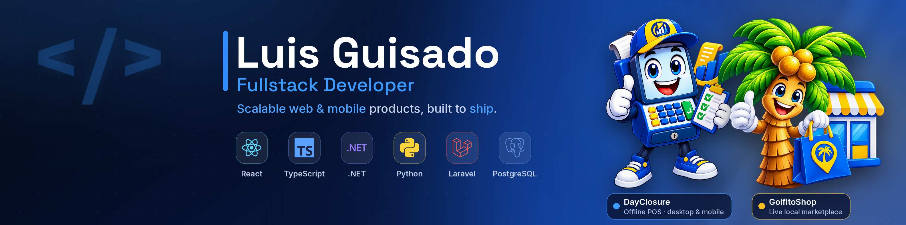
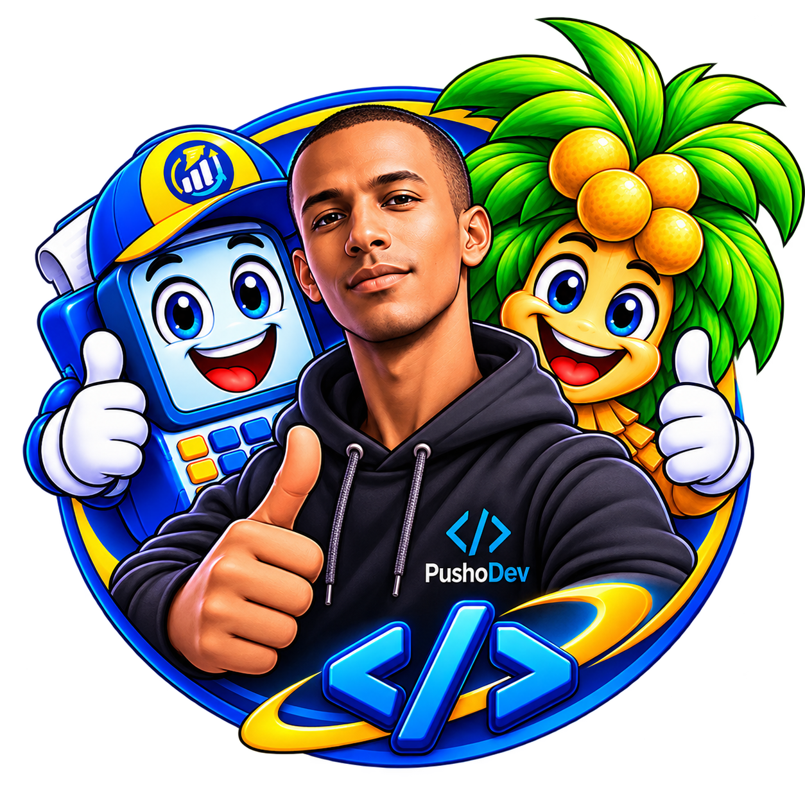
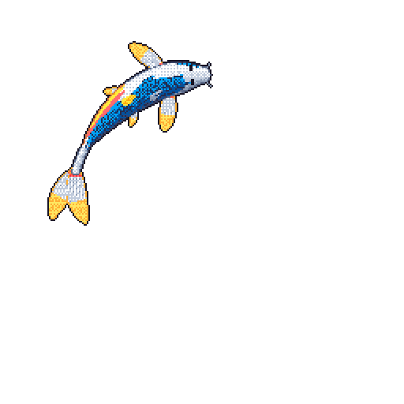

  <kbd></kbd>
  <kbd></kbd>

---

<table align="center">
  <tr>
    <td width="60%" valign="top">

  <h2>👋 ¡Hola! Soy <b>PushoDev (Luis Alberto Guisado)</b></h2>
  
💻 <b>Desarrollador Fullstack con 8+ años de experiencia</b> construyendo sistemas web en producción: un marketplace, un ERP/POS multi-almacén y aplicaciones móviles y de escritorio. Trabajo con <b>Laravel, React, Python (Django/FastAPI) y .NET</b>, y mi entorno de día a día es <b>Linux con Podman</b>.

  
⛓️ Estoy dando el paso de <b>Fullstack a Fullstack Blockchain</b>: aprendo Solidity y Foundry, e integro contratos con Laravel y React. Todavía en formación; los proyectos Web3 de mi portfolio son ideas, no productos terminados.

  
🌍 <b>Disponible para trabajo remoto</b>. Escribo desde Cuba (UTC-5) y la <b>zona horaria es negociable</b>: me adapto al horario de tu equipo.

  

  
  
  
  

  </td>
  <td width="40%" align="center">
    
  </td>
  </tr>
</table>

---

<h3 align="center">💻 Ingeniero Fullstack | Laravel • React • Python • .NET | Sistemas en producción · Trabajo remoto</h3>

---

## 🌟 Acerca de mí

> *Transformando ideas en soluciones digitales escalables a través de código limpio y tecnologías modernas.*

Soy fundador de **GolfitoShop** (marketplace local en producción) y desarrollo **sistemas a medida** para negocios reales: ventas, inventario multi-almacén, cierres de caja y bots de Telegram.  
Trabajo con **PHP, Laravel, Python, TypeScript, React, Django, FastAPI y .NET**, con **MySQL, PostgreSQL y MongoDB**, y despliego con **Docker/Podman y GitHub Actions**.  
También construyo apps móviles con **React Native + Expo** y de escritorio con **Tauri**.

🌱 Me apasiona aprender, compartir lo que sé y mantener los sistemas simples y fiables.  
🎓 Grado en Ingeniería (Universidad de Granma, 2018–2022).

---

  
  
  
  
  

---

## 🚀 Tecnologías

### 🖥️ Frontend

### ⚙️ Backend

### 🗄️ Bases de datos

### 🧰 DevOps / Herramientas

### 📱 Móvil y escritorio

### ⛓️ Blockchain · aprendiendo

---

## 🧩 Proyectos destacados

- 🔹 [**GolfitoShop**](https://golfitoshop.posglorietashop.com) – Marketplace local de Granma (Laravel + React + PostgreSQL). **Fundador · en producción.**
- 🔹 **almacen.tienda** – ERP/POS multi-almacén con roles, cierres de caja y conciliación. **En producción** (repositorio privado).
- 🔹 **DayClosure** – ERP/POS de escritorio y móvil, sin conexión (Tauri + React). **En desarrollo.**
- 🔹 [**Re & Re**](https://github.com/PushoDev/re-remesas) – Remesas y recargas (Django + DRF / React). **Entregado.**
- 🔹 [**Portfolio React + TypeScript + Tailwind**](https://github.com/PushoDev/pushodev-portfolio) – Bilingüe ES/EN, en [pushodev.vercel.app](https://pushodev.vercel.app).
- 🔹 [**Dashboard FastAPI + React**](https://github.com/PushoDev/sistema.gestion-fast) – Panel administrativo con autenticación y estadísticas.
- 🔹 [**Drone Med (NestJS + PostgreSQL)**](https://github.com/PushoDev/drones-api) – API REST para drones de transporte de medicamentos.
- 🔹 [**Blog cultural**](https://github.com/PushoDev/blog-cultural-manzanillo) – Sitio de contenido cultural.

> 💡 Descubre más en mi [portfolio](https://pushodev.vercel.app) y mis [repositorios de GitHub](https://github.com/PushoDev?tab=repositories).

---

## 📈 Estadísticas

  
   
  

---

## 🐍 Snake de desarrollo

---

## 🐟 Mi koi

  
   
  Se redibuja cada noche con mi actividad pública · <a href="https://github.com/yalongwastaken/git-koi">git-koi</a>

---

---

## ✍️ Últimos artículos técnicos

<!-- BLOG:START -->
<table align="center">
<tr><td align="center" valign="top" width="340"> <a href="https://dev.to/pushodev/add-a-living-pixel-art-koi-to-your-github-profile-readme-in-5-minutes-1827"><b>Add a living pixel-art koi to your GitHub profile README (in 5 minutes)</b></a> 2026-11-13</td></tr>
</table>
<!-- BLOG:END -->

> 📚 [Ver todos mis artículos en Dev.to](https://dev.to/pushodev)
